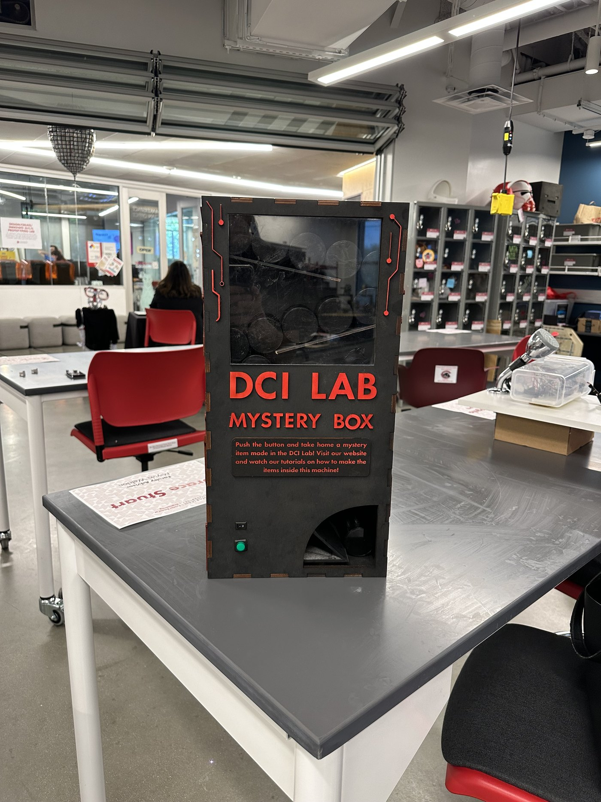
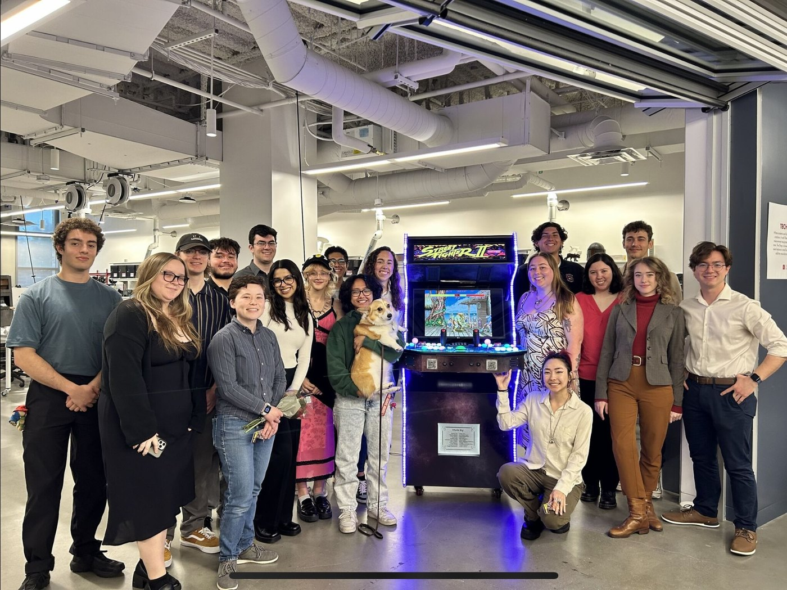
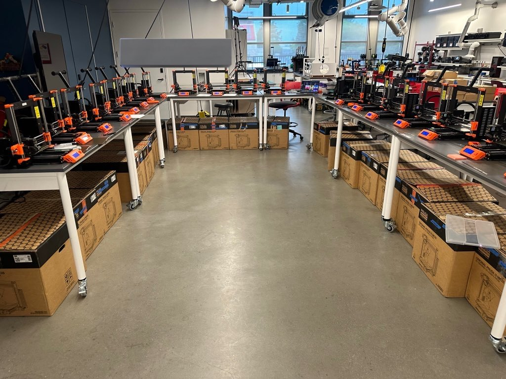
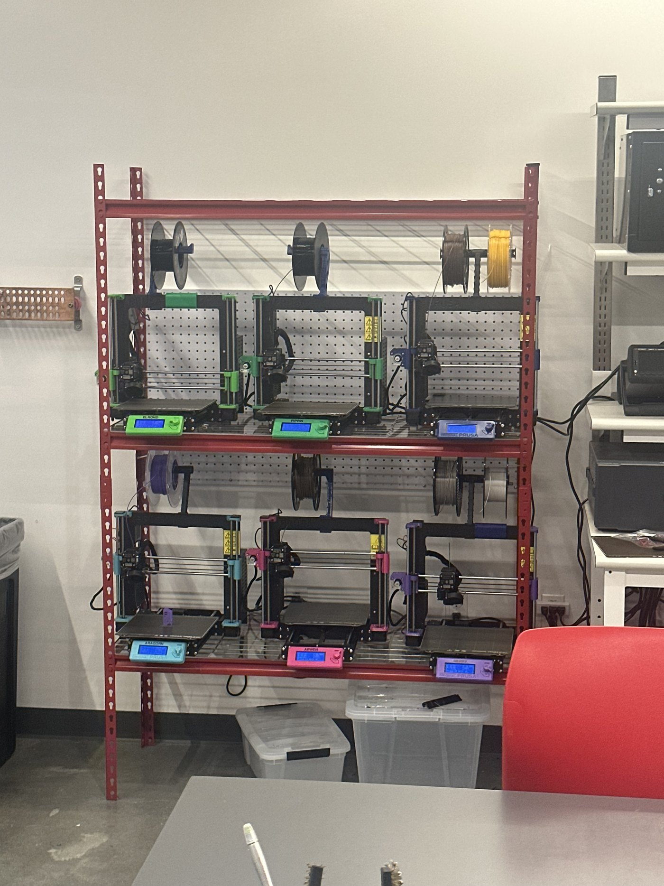
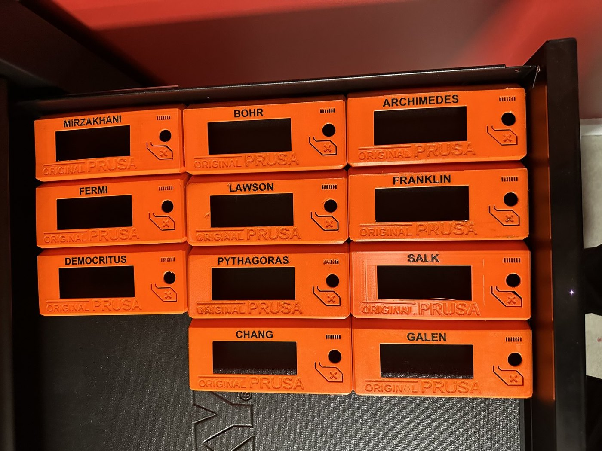
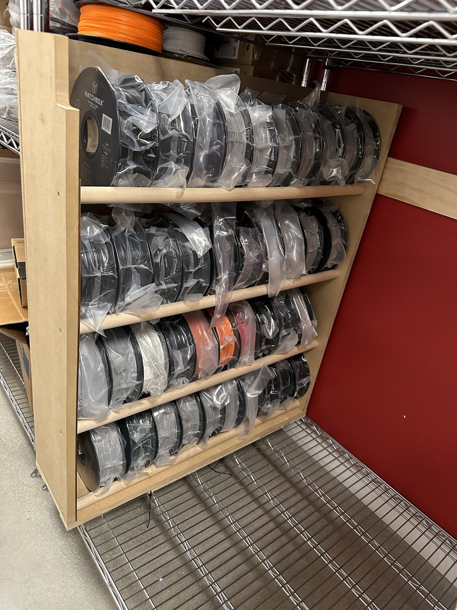
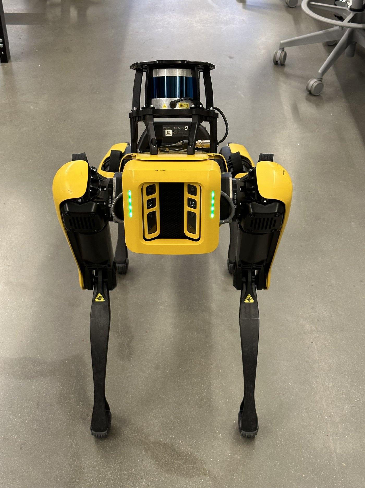

I was offered a temporary job at Chapman University working under the Makerspace
manager to help maintain the equipment. Chapman University's makerspace is very
impressive as it has multiple CNC and manual Mills, CNC Routers, every state of
the art printing method (SLS, SLA, Full Color, FDM), Vinyl, Embroidery, and
Sublimation machines.

## Mentoring

A large part of my job was helping students design and engineer their own projects
from ENGR 300, the Chapman Make-A-Thon, and other mixed engineering classes.
Students would come daily with projects such as a toy vending machine or a LEGO
compatible rollercoaster track and it was my goal to outline what had to be done,
and help them accomplish it. Some of the time it would be electrical specific,
software specific, or manufacturing specific and my role was to make sure the best
approach is being provided.

My favorite project was the Makerspace Arcade Cabinet.
Several students worked together to build an arcade cabinet, and it involved many
different teams from management, electrical wiring, display, compute, and design. I
was there to help students with any individual portion, and help fabricate parts to
fix holes in the plan. At the end of the project I was very pleased to find out
they put my name in the credits of the project.

## Additive manufacturing

For Chapman's ENGR 300 class, each student is given a Prusa MK3S+ to take home and
use for the entire semester. One of my jobs was to check every component on the 50
printers, run various print tests, and tune the printer for each student. I would
often come and give lessons at the class, and help students who bring their
printers in during class troubleshoot their problems.

Students not enrolled in the class also had the opportunity to print on campus
using 9 available MK3s+ as well as a Prusa XL, of which I was to maintain and
manage the printers to make sure every printer was properly utilized and
maintained. I was tasked as well as remaking the faceplates to have the names of
each printer available.

The makerspace also had an issue with the storage of filament. Every cabinet in
the shop had at least 27 spools of filament, some of which degraded and became
brittle after years of storage. I spent time sorting quality filament, and built a
storage system used in the office to store filament in smaller space.

Chapman utilized an industrial cloud slicer called 3DPrinterOS which was not set up
on the office printers. I was able to set them up by taking Raspberry Pi SBCs and
flashing the OS, and manually setting up WIFI Supplicant files to connect to
eduroam in terminal interfaces.

## Boston Dynamics

Chapman University owns two SPOT robots made by Boston Dynamics, but due to the
lack of use most of the batteries were dead. I communicated with Boston Dynamics
and management at the university to get replacement batteries, as well as spent my
time afterwards making the robots accessible for workshops.

## CNC milling

The Tormach mill in the makerspace was one of the most protected pieces of
equipment and was generally only allowed to be operated by the makerspace manager,
but was one of my largest goals for my continuation of my hardware journey. The
manager offered to let me come before work and learn the mill on my free time,
which I took advantage of. These lessons allowed me to learn enough to purchase my
own Haas and continue my hardware journey.
