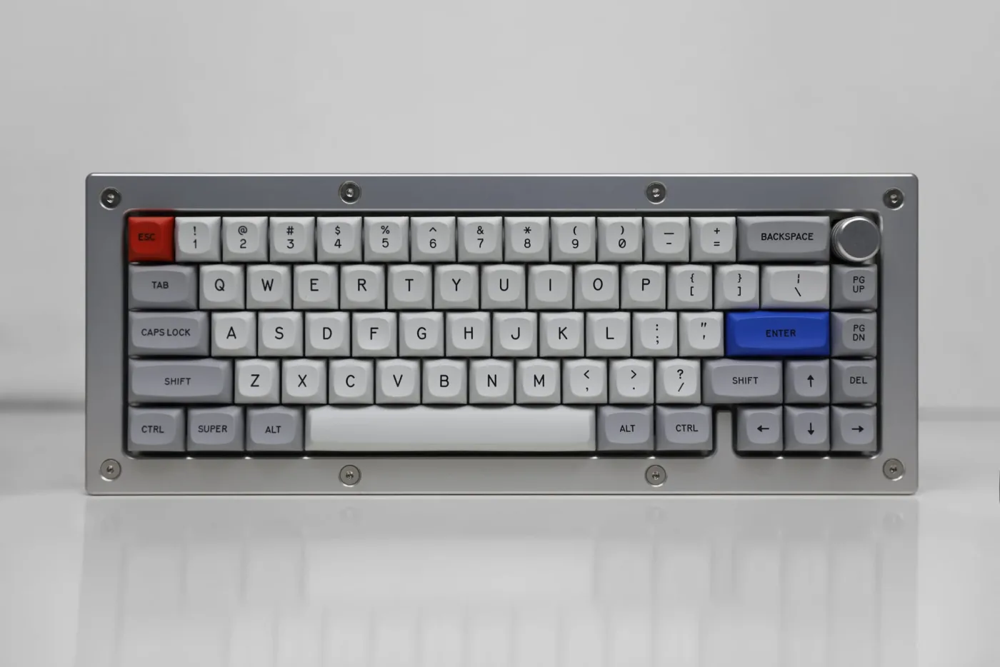
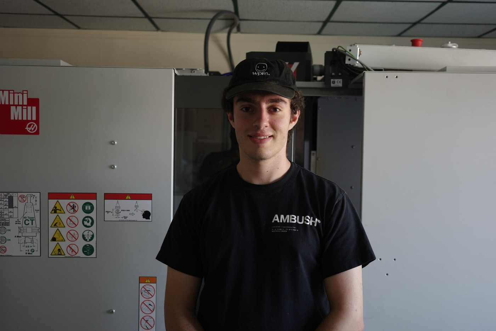
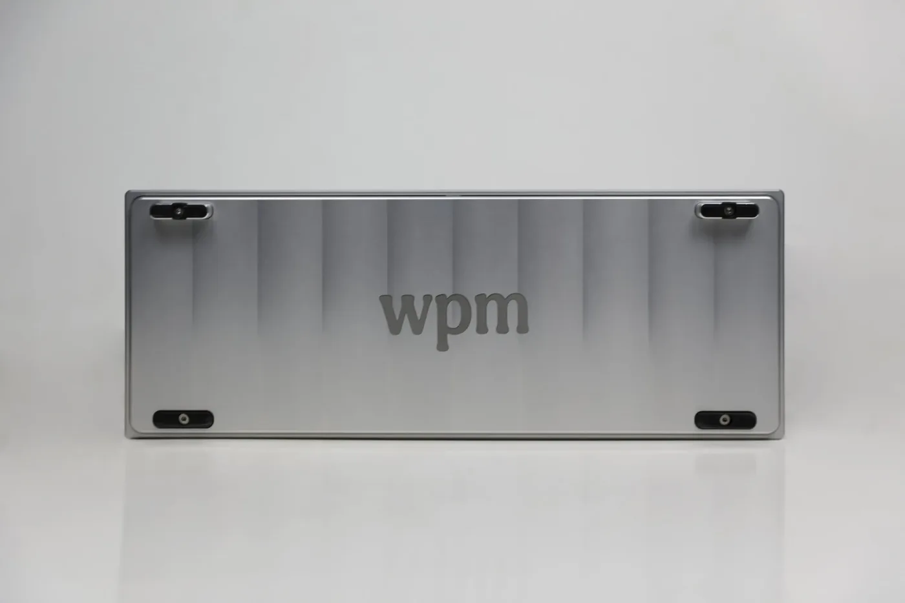

wpm is an American hardware company making luxury full-metal mechanical
keyboards, and is proudly entirely machined and assembled in the USA. Our
flagship product is the type65, made entirely of 6061 Aluminum and rubber, with
no adhesives.

## Where we came from

I started wpm in 2020 after buying a luxury keyboard from a foreign company. The
product was a groupbuy that took 1.5 years to arrive, and was my first impression
of the groupbuy and pre-order model of business.

Further research into the hardware market showed that groupbuys were a shared
practice, and in many cases led to scams on the customer and bankruptcies on
companies. That inspired me to manufacture products in house, and to focus on the
luxury of a premium product delivered quickly.

## What luxury means here

What defines a product or company as a luxury business? Is it the price tag paid,
the logo on the product, or who is seen with the product? A luxury product is
decided by the customer and their hopes of the product. In a large sense, wpm is an
extension of my hopes of when I buy a product. I hope that a product I buy is made
to last, made of quality materials, is repairable and serviceable. My sense of
luxury is a product that is reliable, which makes wpm what it currently is.

## Why we make it in house

wpm originally had the goal of having China produce the products and we would sell
them. Doing this leaves less to worry about as an owner in terms of making the
product, but ultimately makes the owner blind to the process and can put the
company at the call and beckon of the factory. If prices go up, the company has to
suffer. But by manufacturing in the USA, we are aware of every price increase.

## How we funded the workshop

When we decided to switch to in house manufacturing, we picked a field that we can
afford to manufacture at low cost, which was clothing. We screen printed and
embroidered shirts and hoodies for a handful of companies to pay for the CNC
machine, and we spent months learning how to operate it efficiently.

We operate out of my parents’ place. A lot of what we have made has gone into that
property instead of out of it, and everything the business runs sits inside it.
What we are working toward now is the next CNC and the other large-figure
equipment.

## How we make our keyboards

Our workshop is built around CNC milling. A fiber laser handles engraving, and
SLA and FDM 3D printing let us prototype before cutting metal.

Our designs are shaped by our equipment. We run 3-axis machines, so we avoid
designs that need multiple setups for angled features. We minimize material per
part, tune feeds and speeds, and cut as quickly as quality allows. Scrap and
chips are recycled to offset material costs.

## A local, American supply chain

Everything is made in the USA, and most of it within Southern California: metal
from Burbank, anodizing in Orange, and recycling in Downtown LA. We buy plate
rather than bar where it’s more economical, and we use commitment deals timed
around monthly metal price changes.

