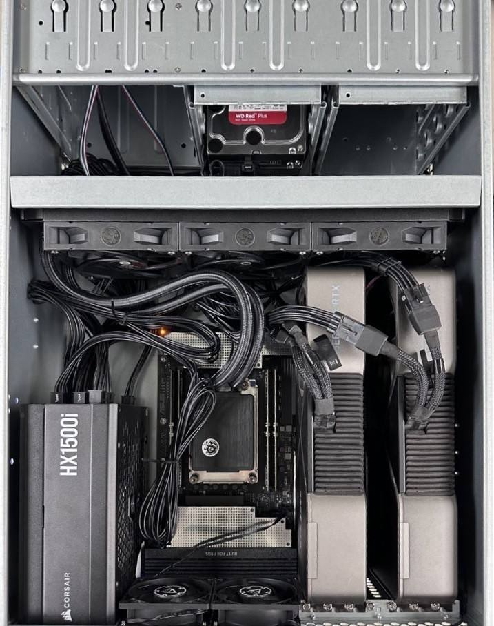

## The decision

Every model I use runs on a machine in this house: no API keys, no per-token
bill, no provider that can swap the weights underneath me between one Tuesday
and the next.

What that bought is not free inference. It is the ability to answer questions a
cloud console cannot: what a quant actually costs in quality, what a driver
rebind does to CUDA, how much of "the model is slow" is measurement error. Those
answers only exist because I can break this box, measure it, and put it back.

What it cost is a permanent constraint: one machine, 48 GB of VRAM, one model
resident at a time, a 25–80 second swap when the model changes, and a box that
has to hand its GPUs to a Windows VM when someone wants to play a game. The rest
of this piece is that constraint, and what survived it.

## The machine, and the tension

It is a Threadripper 9970X with 125 GB of RAM, two RTX 3090s, and a job
description that changes depending on who asks: a development box, an inference
server, and the PC someone uses to play games on a Windows VM.

That tension is the whole design. Everything below is a consequence of it.

## The constraint, stated as arithmetic

Decode speed on a dense model is not a mystery. Every generated token requires
reading the whole weight file, so the ceiling is bytes of weights divided by
memory bandwidth. With `--split-mode layer` llama.cpp runs layer blocks
sequentially, so a single stream gets **one card's** bandwidth (~936 GB/s), not
both:

```
Qwen3.8-27B Q8_0 (29.05 GB) / 936 GB/s ≈ 32.2 tok/s ceiling
measured: 28.6 tok/s = 89% of it
```

That number ended a lot of tuning. At 89 % of the theoretical ceiling there is
nothing left in flags, drivers, or firmware, only three structural moves:
amortise the weight read (speculative decoding), read fewer bytes (a smaller
quant), or split each layer across both cards (a tensor-parallel engine, which
the GGUF stack is not).

## What actually runs

A router called llama-swap sits on `:8081` and speaks the OpenAI API. Clients
point at one URL and name a model; the router starts the right engine for that
model, and stops the one before it. Seven entries today:

| Entry | Weights | Engine | Decode |
| --- | --- | --- | --- |
| `qwen3.8` / `-uncensored` | 27B dense, Q8_0, 29 GB | llama.cpp + MTP | 59–66 tok/s |
| `glm-5.3-flash` | 320B-A18B MoE, UD-IQ3_XXS, 120 GB | llama.cpp, CPU-offloaded experts | 24 tok/s |
| `glm-5.3-flash-maya` | same weights | Maya engine | 54–60 tok/s |
| `glm-5.3-flash-legacy` | MoE, Q2_K, 144 GB | llama.cpp | 18 tok/s |
| `deepseek-v4.1-flash` | 763B MoE, 277 GB on NVMe | Maya engine, expert cache | 79–90 tok/s |
| `deepseek-v4.1-flash-abliterated` | same, one shard swapped | Maya engine | 61 avg / 91 peak |

One model is resident at a time. That is not a limitation I picked: 48 GB of
VRAM and 125 GB of RAM cannot hold two of these, and pretending otherwise is
how you end up with two engines fighting over the same cards and both running
correctly but slowly. Swapping is explicit, it costs 25–80 seconds from NVMe,
and the router hides it behind the request that triggered it.

The 763B entry is the one worth explaining, because the arithmetic says it
should not fit. It does, because only the trunk is resident: the model streams
experts from a page-cached table on the NVMe, and the engine reports the split
that matters: 4,226 expert slots in VRAM against 11,134 in RAM, a 0.58 VRAM
hit rate. That ratio, not the model size, is why a 277 GB pack answers at 80+
tok/s on 48 GB of VRAM. More cards would buy speed here; more RAM would not.

## The trade: the same box is a gaming PC

One 3090 is on the motherboard, the other is on an external enclosure. Both can
be handed to a Windows VM with vfio, which is how the machine is a games PC at
all. A small script toggles between the two lives: `host` force-shuts Windows,
unbinds both cards from vfio, and restarts the router; `vm` releases the cards
and hands one to the guest.

The failure mode here is instructive because nothing reports it. After a rebind
from vfio back to `nvidia`, CUDA comes back half-broken: the driver loads, the
router starts, `/health` returns `200`, a model loads, and every request works,
at about **4 tok/s**, because the process has silently fallen back to CPU
inference. Service health said fine. Resource state did not.

The fix is a full reset cycle rather than a reboot: unbind both cards, unload
`nvidia` and its UVM/DRM modules, do a function-level reset on each GPU,
reload, rebind. About forty seconds, and CUDA is healthy again. The lesson
outlived the bug: a health endpoint proves a process is listening, not that it
has the hardware. The only honest check is to generate tokens and time them.

## Where the speed actually came from

Three changes account for everything, and each one was measured against the
same prompt before it shipped.

**Speculative decoding on the dense model.** The Q8_0 weights ship their own
MTP head, so the build can draft several tokens and verify them in one pass.
`--spec-type draft-mtp --spec-draft-n-max 3` took decode from 28.5 to
**66.4 tok/s greedy (2.33×)**, with 70 % draft acceptance, 7 % slower prefill,
and 3 GB more VRAM. Real traffic settles at 59–61 tok/s, which is the number I
quote, not the bench peak.

**A different engine for the MoE.** The same GLM weights run 24 tok/s under
llama.cpp (experts in RAM, layer-sequential) and 54–60 tok/s under Maya, which
loads the MTP block llama.cpp ignores and keeps an expert cache at an 83 % hit
rate. It is not free: prefill drops from ~1,840 to ~770 tok/s and the model
loses vision, so the llama.cpp entry stays for image input and long first
prompts. Two entries, same weights, chosen per request.

**A smaller quant that is also more accurate.** Moving GLM from vanilla Q2_K
(144 GB) to UD-IQ3_XXS (120 GB) cut bytes per token by 16 % and gained a
quality tier at the same time: 21.1 → 24.2 tok/s decode, 482 → 516 prefill, RSS
103 → 86 GB. The expert split had to be retuned for the new tensor sizes. The
old `--override-tensor` ranges OOM'd device 0. A quant swap that keeps the old
split produces a deployment that works and runs no faster, which reads as "the
new weights are no better".

## Four bugs that looked like a broken model

None of these produced an error a user would recognise. All four were found by
measuring the layer that was actually failing.

1. **HTTP 500 on every request.** The chat template accepted only `xhigh`,
   `medium`, `low`; the client sent `high`, the Jinja template raised, and the
   server returned 500. The model was fine; the template was a whitelist.
2. **Empty answers with `finish_reason: length`.** Thinking has a token budget
   and the client capped output below it, so the model spent the entire budget
   reasoning and never wrote the answer. A 2,000-token cap returned zero
   characters on an "explain in detail" prompt. Nothing was broken; the two
   budgets were fighting.
3. **Five minutes to first token after every restart.** The router's startup
   hook preloaded a model whose weights sit on the spinning disks: 28 GB at
   ~41 MB/s. Pointing the hook at an NVMe-resident model took the wait under a
   minute.
4. **Correct answers at 4 tok/s.** The vfio fallback above. `nvidia-smi` was
   the tell, not the service state.

The common shape: the system was doing exactly what it was configured to do.
Each fix was one line in a config; each diagnosis was the hard part.

## What production looks like

The router logs every request to SQLite, which is the only source of truth that
matters: actual traffic, not benchmarks. Across 2,524 requests:

| Model | Requests | Avg tok/s | Peak tok/s |
| --- | --- | --- | --- |
| Qwen3.8 uncensored | 1,249 | 23.7 | 75.4 |
| GLM-5.3-Flash (llama.cpp) | 449 | 20.0 | 25.2 |
| DeepSeek (abliterated) | 302 | 61.2 | 90.9 |
| DeepSeek | 208 | 60.8 | 100.7 |
| GLM-5.3-Flash (Maya) | 65 | 53.2 | 64.5 |

The Qwen average is dragged down by three months of history that predates the
MTP change; its recent traffic is the 59–61 above. The averages are honest in a
different way too: most turns are short, so the number a user feels is the
cold-prompt latency plus prefill, not the steady-state decode.

## What I would change

- **Turn EXPO on.** The four DDR5-5600 modules run at 4800 JEDEC: roughly 17 %
  of memory bandwidth left on the table, on a box where every CPU-offload config
  is bandwidth-bound. It is a BIOS setting and the cheapest speedup available.
- **Put the router config in git.** It is backed up by `cp config.yaml
  config.yaml.bak-<timestamp>`, which is not a system. One apply script, one
  diff, one rollback.
- **Alert on throughput, not uptime.** Every failure above kept the service
  green. A single check that a request produces 40+ tok/s on the resident model
  would have caught the expensive one in a minute.

The decision still holds, and the receipts are in this piece: 2,524 logged
requests, 79–90 tok/s from a 763B model on 48 GB of VRAM, a quantization change
measured against the same prompt before it shipped. What would end it is not a
better API. It is the box stopping being a games PC, or the swap becoming the
thing a user feels. Neither has happened.

If you are hiring for infrastructure or ML platform work, the address is in the
footer.
