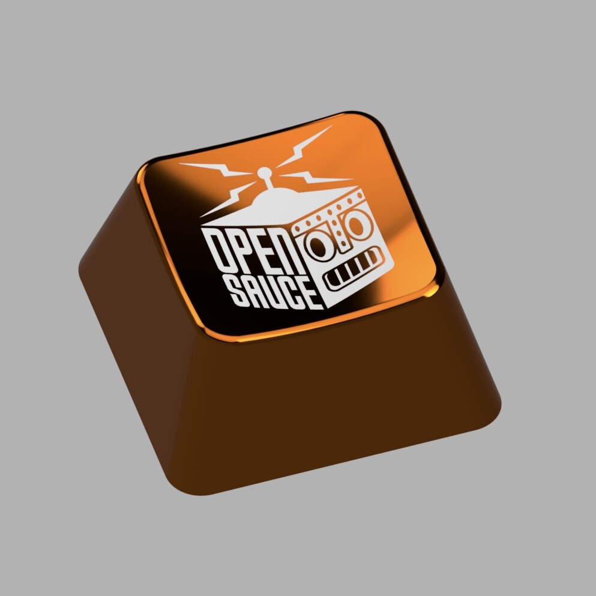
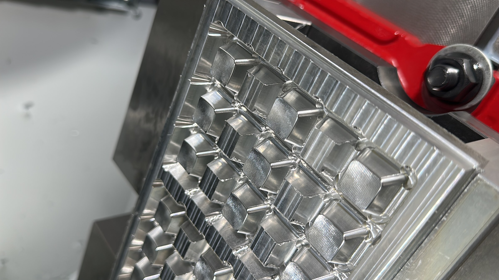
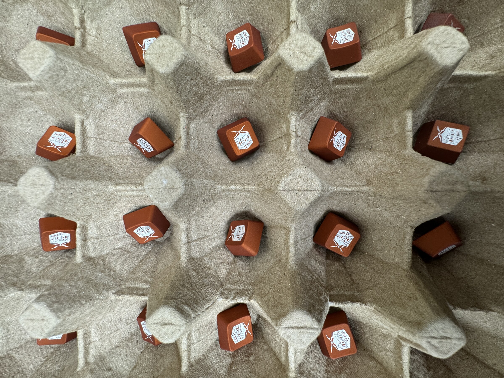
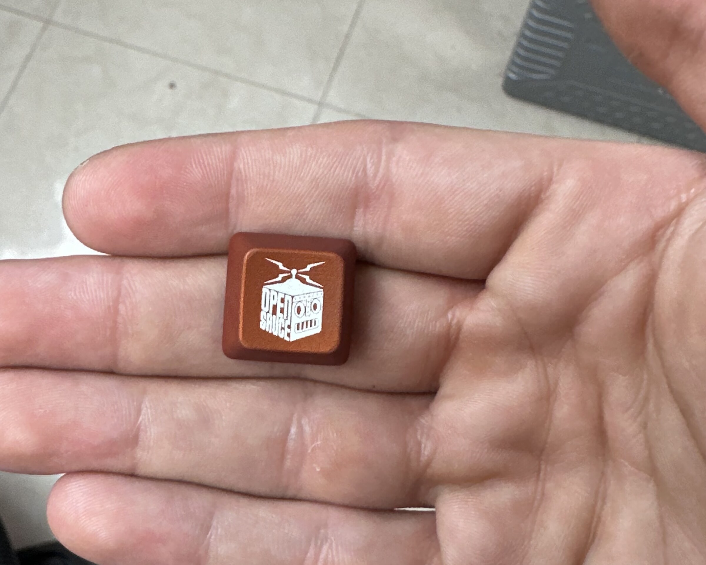

We went to OpenSauce in 2025 to share our prototype type65 keyboard and asked the
organizers at OpenSauce if we could machine keycaps to give away at the event.

Upon approval, we purchased 6061 aluminum and used chamfer end mills to make
Cherry style keycaps of our own design, using a single chamfer on all sides and
removing the angled surface off the top of the keycap.

Upon finishing and deburring the 100 keycaps we made, we took them to Dunham
Metals in Orange, CA and let them do a type 1 anodizing with a brown dye sealing
process. We received the keycaps and then switched to marking.

We utilized a 60W fiber laser, and employed a white marking technique. We designed
a jig for the laser with the FDM printer and printed them all, as well as laser
engraved metal business cards to come with them. The final results were
impeccably clean, and it was a very fun and interactive experience to share the
passion we have for engineering in the form of gifts for STEM enthusiasts.

