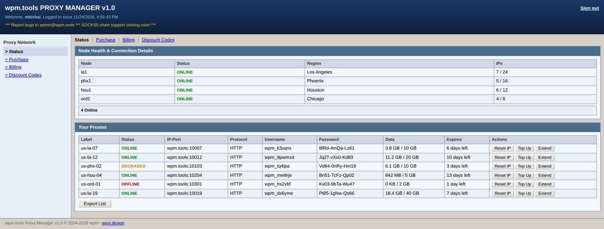
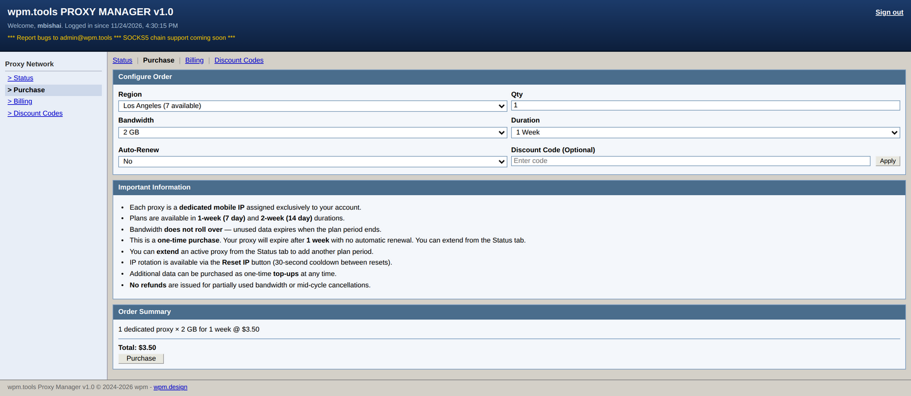

My prior startup, [Vanish Proxies](/experience/vanish-proxies/), shut down in 2022
due to a lack of demand in markets that would involve proxies such as scraping, and
botting. The datacenter colocations and minimum payments for the infrastructure were
not justifiable, especially while I was completing my BS in Computer Science.
Although the business ended, the business of proxies and identities has never been
larger.

AI agents began to emerge in late 2024, and often involve businesses or individuals
setting up computers, connecting an inference engine to a harness such as Hermes
Agent, Claude Code or pi, and allowing a model to make both novel and advanced
decisions on computers, such as emailing, booking reservations, writing code, or
even assessing cybersecurity risks. Proxies are now extremely valuable for
individuals to let their agents do work while being able to avoid rate limits and
403 responses (forbidden requests). However, the proxy industry is full of
malignancies that will ultimately need to be sorted. Residential proxy networks in
large part exploit unread terms of service in mobile and TV apps to allow the device
to tunnel traffic, which ultimately can be used in a criminal manner and ends up
pointing the finger at the person who owns the device. The goal of this project was
to build an extremely low cost proxy network without malignant usage.

## The requirements

Given prior explanations, the proxy network ultimately needed the following
requirements:

- All devices routing traffic are self owned.
- IP quality must be clean enough to scrape with.
- Multiple locations, with sustainable expansion if necessary.

## Deciding on hardware infrastructure

Referencing earlier in this article, any device can behave as a proxy; a TV can
behave as a proxy, a phone can act as a proxy, and a printer can behave as a
proxy. This is because each device already has its own networking card, but this
means that only one unique IP can be given per device. It wouldn't make sense to
pay hundreds for any of these devices to have them act as proxies. On the other
hand, there are specialized networking devices that have multiple networking
cards, but cost hundreds to thousands per. Ultimately, the price per proxy is
what influenced my decision.

After lots of research, I found travel hotspots that are made by Marvell which
used 4G LTE to make a wifi network. I purchased these for 35 dollars per proxy,
which ultimately was the most affordable option.

## Cellular networks and relocation

Cellular networks is an excellent way to set up internet access quickly. In
traditional IP networking, the ISP will generally allow for only /24 subnets, or
charge per additional IP. Additionally, the subnets may be used improperly, and
end up requiring replacement, or a location change may be needed which would
ultimately be financially difficult. Cellular networks on the other hand pull IP
addresses from the nearest cell tower, and thanks to reverse engineering the USB
hotspot's admin panel, sending commands like rotating IPs from the cell tower is
more than easy. Finally, thanks to these modems being tiny and easy to move and
store, getting IPs from different regions is attainable by putting more modems in
different locations, and networking is easy as each SIM provider can ultimately be
swapped if needed.

## Serving infrastructure

The infrastructure is two systems, and each of them is two roles.

**Proxy network**

- **Node** — the machine that has the modems plugged in. When it is set up, it
  points at a hub server and gives itself a name:

  ```sh
  ./hotspotd -mode node -hub-addr hub.example.com:9090 -node-name box1
  ```

- **Hub** — the control plane. It allocates public ports against the domain,
  authenticates every potential customer, handles failsafe issues, and tracks its
  own state as well as traffic for metered coverage.

**Website** — a TypeScript site built for a retro environment, circa 2010.





## Final words

Ultimately, this network has met all my desires. I can see this expanding by
offering people who host these networks with me a split of the data top-up
margins after the cellular carriers collect my margin. I decided not to publish
this code for multiple concerns:

1. The FCC banned foreign routers from entering the USA without approval. This
   would risk the supply chain for the USB hotspots, and raised fear of
   compliance.
2. AI has a lot of malignant uses. Part of closing my original proxy company was
   a dissatisfaction with catering to people who make their money scalping. AI
   agents are incredible but also have unlimited use cases of which I do not
   consider making them more anonymous beneficial for the greater good.
